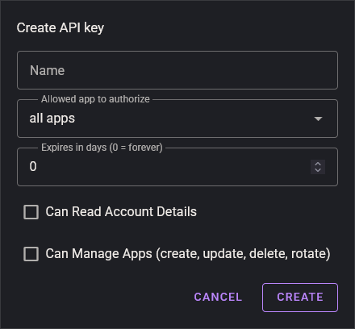

# NPM SDK for id.ehis.gay

The SDK for [id.ehis.gay](https://id.ehis.gay) for npm, which you can do logins or use the API to create apps inside of code 

# How to use

## install

```sh
npm i id.ehis.gay
```

## logins

it does the oauth stuff for you, you only write the client details and id.ehis.gay handles the rest

```ts
import { login } from "id.ehis.gay";

const oauth = login({
  clientId: "your-client-id",
  clientSecret: "your-client-secret", // Native apps don't need client secrets!
  redirectUri: "https://yourapp/auth/callback",
  apiKey: "ehg_...", // Append API Key if the app is private and you are testing
});

const codeVerifier = oauth.createVerifier();
const url = await oauth.authorizeUrl({ state: "a-random-state", codeVerifier });

const tokens = await oauth.exchange({ code: "the-code-from-the-callback", codeVerifier });
const user = await oauth.userinfo(tokens.access_token);
```

### nuxt / nitro

```ts
import { nitroLogin } from "id.ehis.gay/nitro";

const auth = nitroLogin({
  clientId: "your-client-id",
  clientSecret: "your-client-secret",
  redirectUri: "https://yourapp/api/auth/callback",
});

// server/api/auth/login.get.ts
export default defineEventHandler(async (event) => sendRedirect(event, await auth.loginUrl(event)));

// server/api/auth/callback.get.ts
export default defineEventHandler(async (event) => {
  const { user, tokens } = await auth.callback(event);
  await setUserSession(event, { user });
  return sendRedirect(event, "/");
});
```

## apps and account

You can not also do login, but do stuff with your id.ehis.gay with an API Key!

```ts
import { apps, account } from "id.ehis.gay";

const manage = apps({ key: "ehg_..." });

await manage.list();
await manage.create({ name: "my app", redirectUris: ["https://myapp/auth/callback"] });
await manage.update(clientId, { redirect_uris: ["https://myapp/auth/callback"] });
await manage.setVisibility(clientId, true);
await manage.setProviders(clientId, ["github", "discord"]);
await manage.rotateSecret(clientId);
await manage.remove(clientId);

const acct = account({ key: "ehg_..." });

await acct.apiKeys.list();
await acct.apiKeys.create({ name: "ci", canManage: true });
await acct.apiKeys.update(apiKeyId, { canManage: false });
await acct.apiKeys.remove(apiKeyId);
await acct.consentedApps.list();
await acct.consentedApps.revoke(consentId);
```

## API Keys



some things need an api key, like logging into a **private** app or doing any of the account and app stuff above, you can make one [right here](https://id.ehis.gay/dashboard?section=account&key), tick **can manage apps** if you want it to do the stuff above, otherwise you can do logins for **public apps**